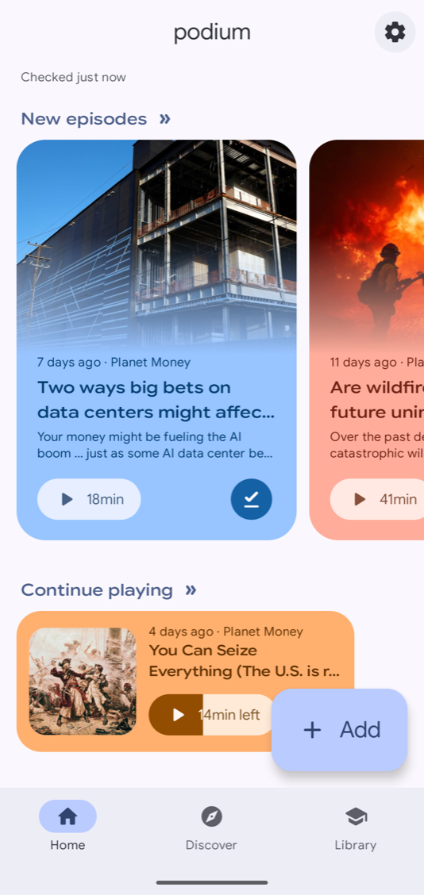
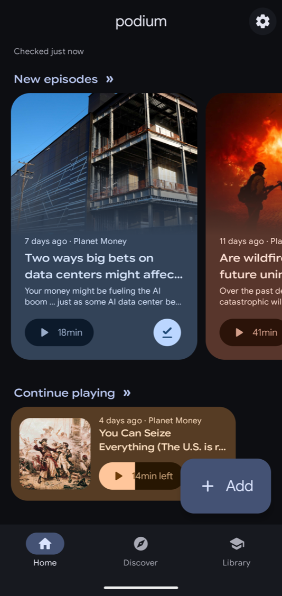
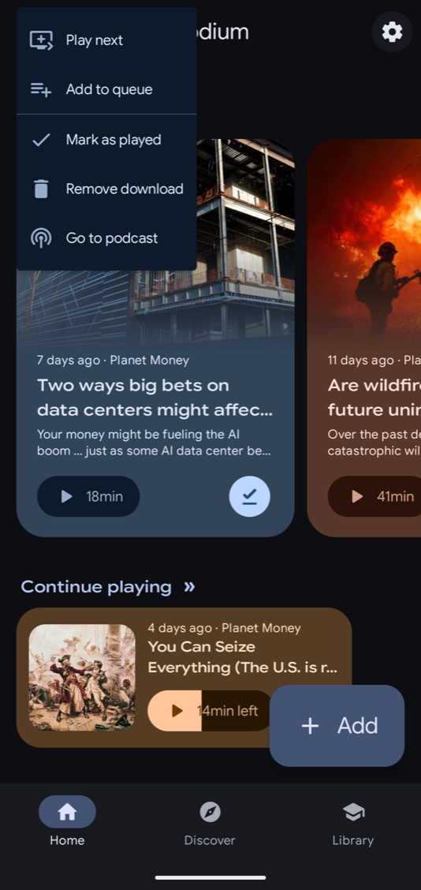
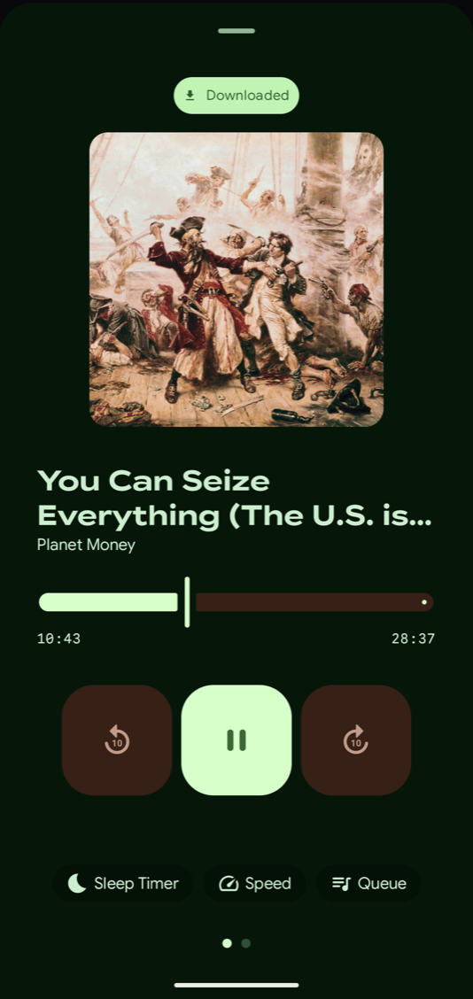
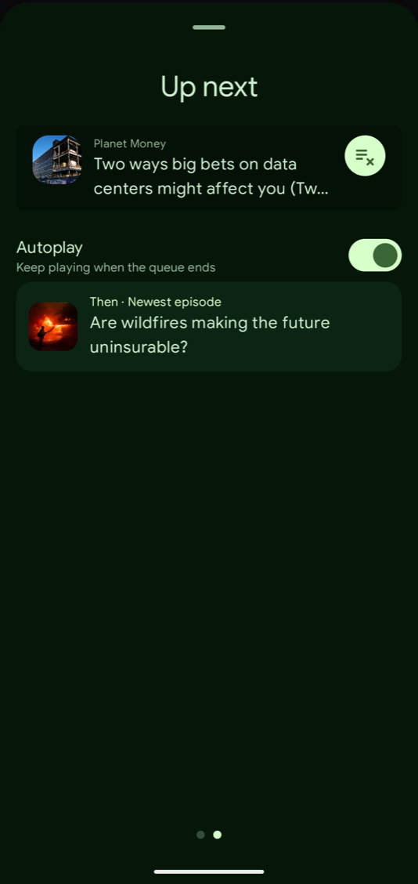
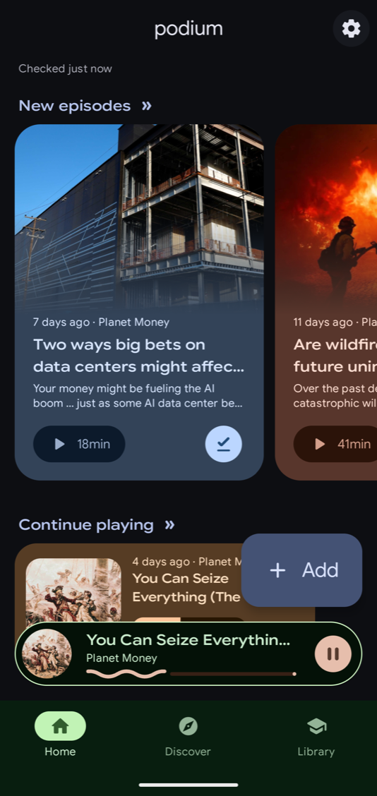
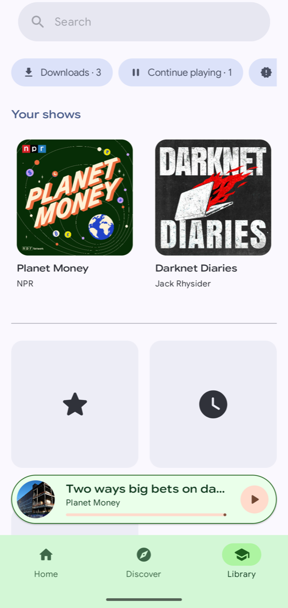
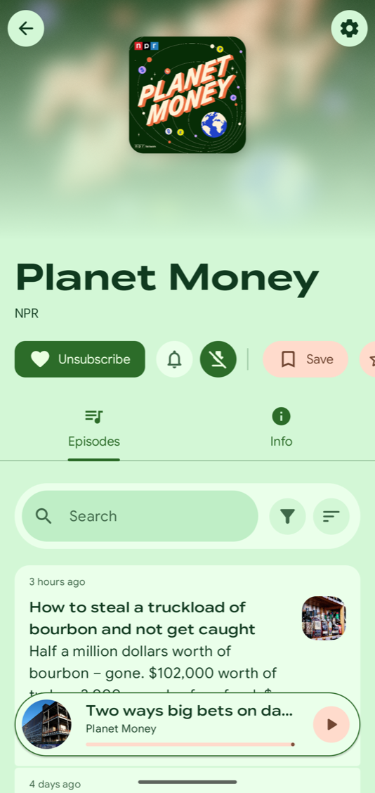
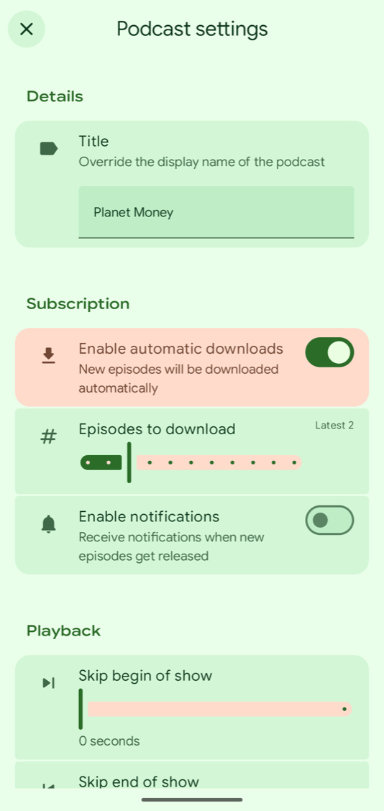

<p align="center">
  
</p>

<h1 align="center">podium · listening-first fork</h1>

<p align="center">
  A fork of <a href="https://github.com/aimok04/podium"><b>aimok04/podium</b></a>, the beautiful Material 3 Expressive podcast app for Android,<br/>
  with a Home tab built around <i>what to listen to next</i>, a real queue, autoplay, and smarter downloads.
</p>

<p align="center">
  
  
</p>

> [!NOTE]
> All the credit for podium goes to [aimok04](https://github.com/aimok04). This fork only adds features on top, and every feature is offered back upstream as a separate pull request ([see below](#-upstream-pull-requests)).
> If you just want a great podcast app, the [official podium](https://github.com/aimok04/podium) is the place to start.

---

## 🏠 A Home tab for listening

The new Home tab answers one question: *what should I play next?*

- **New episodes:** large cards for the newest episodes you haven't started. Each card takes its color from its own artwork.
- **Continue playing:** pick up unfinished episodes, with remaining time and progress right on the play button.
- **Your shows:** your subscriptions with big artwork.
- **Pull to refresh**, plus a small "Checked 5 minutes ago" line, so you always know when feeds were last updated.
- Rows snap card by card, and dark mode uses deep, artwork-tinted cards instead of bright ones.

<p align="center">
  
  &nbsp;
  
</p>

## ⏭️ Play next, Up next and autoplay

- **Long-press any episode:** Play next, Add to / Remove from queue, Mark as played / unplayed, Download / Remove download, Go to podcast.
- **Up next:** swipe the player to its second page to see and edit the queue.
- **Autoplay** keeps going when the queue runs out, and the Up next page tells you exactly what comes next and why:
  1. the next newer unplayed episode of the **same show** (great for series and for catching up on daily shows)
  2. otherwise your most recent **unfinished** episode
  3. otherwise the **newest** episode you haven't started

<p align="center">
  
  &nbsp;
  
  &nbsp;
  
</p>

## 🎨 Colors that follow what's playing

While something plays, the navigation bar takes on the same artwork colors as the mini player and the player. Light or dark, it always matches the episode you're listening to.

<p align="center">
  
  &nbsp;
  
</p>

## 📚 A Library with your shows

Library opens on a grid of your subscribed podcasts. Downloads, Continue playing, New episodes and History sit above it as compact shortcut buttons with counts, and your lists follow below.

## 📥 Smarter auto-downloads

- **Episodes to download, per podcast:** *All new* or *Latest 1–10*.
- Turning auto-download on, or changing the number, downloads the latest episodes **right away**, without waiting for the next feed update.
- **Played episodes are never auto-downloaded.** If you stream an episode (or sync marks it as played) while its download is still waiting for Wi-Fi, the download is dropped.

<p align="center">
  
  &nbsp;
  
</p>

## 🐛 Fixes

- The "Use » Podcasts « branding" switch no longer crashes on builds with an application ID suffix.
- Removing an episode that isn't in the queue no longer crashes.
- A manual single-podcast refresh now respects the Wi-Fi-only rule for automatic downloads.

## ✨ New icon

A rainbow voice wave on white, with a monochrome version for Android's themed icons.

---

## 🔀 Upstream pull requests

Each feature lives on its own branch, based on upstream `main`, so it can be reviewed and merged on its own:

| Branch | What it contains |
|---|---|
| [`fix/branding-switch-and-dequeue-crash`](https://github.com/jonasgunklach/podium/tree/fix/branding-switch-and-dequeue-crash) | The two crash fixes |
| [`feature/auto-download-limit`](https://github.com/jonasgunklach/podium/tree/feature/auto-download-limit) | Episodes to download per podcast, no downloads of played episodes |
| [`feature/play-next-queue-autoplay`](https://github.com/jonasgunklach/podium/tree/feature/play-next-queue-autoplay) | Long-press menu, Play next, Up next page, autoplay |
| [`feature/home-library-redesign`](https://github.com/jonasgunklach/podium/tree/feature/home-library-redesign) | Home tab, Library grid, pull to refresh |

The new icon, the colored navigation bar and the `preview` build type are only in this fork.

## 📦 Build and install

There are no release builds of this fork yet. To build an optimized APK yourself (requires the Android SDK and JDK 17+):

```bash
git clone https://github.com/jonasgunklach/podium.git
cd podium
./gradlew assemblePreview
```

Install `app/build/outputs/apk/preview/app-preview.apk`.

The preview build uses the package name `app.podiumpodcasts.podium.debug` and is signed with your local debug key. It installs **next to** the official podium instead of replacing it.

**Moving your data over:** in the official app, go to *Settings → Database and Backup → Export database*. Then use *Restore database* in this build. Subscriptions, play progress and lists carry over; settings and downloaded files don't.

## 📜 License

[GNU General Public License v3.0 or later](/LICENSE), same as upstream podium.
podium was created by [aimok04](https://github.com/aimok04); this fork is maintained by [jonasgunklach](https://github.com/jonasgunklach).
